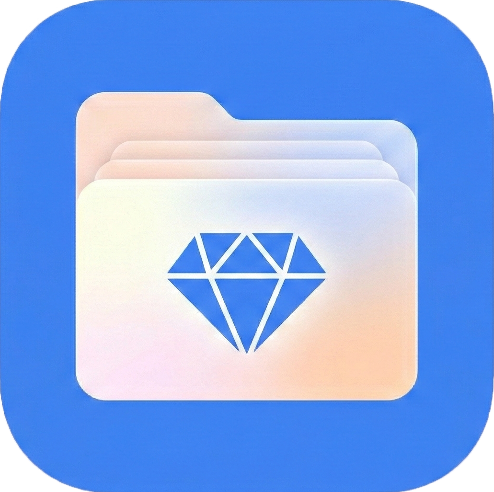

  

<h1 align="center">Gemfolders</h1>

  <strong>Organize your Gemini conversations and ideas in one place.</strong>

  
  &nbsp;
  

  
  
  

---

Stop losing important threads. Gemfolders is a browser extension that brings structure to your Google Gemini workflow with native folders, instant search, and bookmarks — all directly inside Gemini's sidebar.

## 🛠️ What's New in v2.0.4

- **Accounts are back:** Sign in with Google or a Magic Link from the Account tab to sync your folders and bookmarks across devices.
- **Free and Pro plans are back:** Signing in for free doubles your limits, and Pro removes them. Your existing folders and bookmarks are always kept.
- **Reliability and performance improvements.**

## ✨ Features

- **📁 Custom Folders** — Create, rename, and color-code folders to categorize chats by project, topic, or client.
- **🔖 Bookmarks** — Pin important conversations for instant one-click access.
- **🔍 Search** — Instantly find past chats by title or keyword. No more endless scrolling.
- **🖱️ Drag & Drop** — Move chats between folders effortlessly.
- **⚡ Native Sidebar Integration** — Blends seamlessly into Gemini's interface without disrupting your flow.
- **🌗 Theme Aware** — Automatically adapts to Gemini's light and dark modes.
- **🔒 Privacy-Focused** — Without an account, your folders and bookmarks stay local in your browser. We never collect or share your chat content.
- **🔄 Cloud Sync** — Sign in to back up your folders and bookmarks and use them on any computer.
- **📤 Export** — Download your folders, bookmarks, and cached chat info as a JSON file at any time.

## 💎 Plans

| | Folders | Bookmarks | Subfolder depth | Cloud sync |
|---|---|---|---|---|
| Without an account | 5 | 5 | 1 level | — |
| Free account | 10 | 10 | 2 levels | ✓ |
| Pro (monthly, yearly or lifetime) | Unlimited | Unlimited | Unlimited | ✓ |

See current pricing at [gemfolders.com](https://www.gemfolders.com).

## 🚀 Getting Started

Install Gemfolders from the [Chrome Web Store](https://chromewebstore.google.com/detail/gemini-folders-bookmarks/dnlonnjaceadodcffgillnlkgfoaclfi) — it's free to get started.

## 👤 Author

**Emirhan Keskin**

## 🔗 Links

- 🌐 **Website:** [gemfolders.com](https://www.gemfolders.com)
- 🏪 **Github Repo:** [gemfolders](https://github.com/emodeth/gemfolders)
- 🏪 **Chrome Web Store:** [Install Gemfolders](https://chromewebstore.google.com/detail/gemini-folders-bookmarks/dnlonnjaceadodcffgillnlkgfoaclfi)
- 📺 **Demo Video:** [Watch on YouTube](https://youtu.be/zsiw4Z9-ajI?si=hXfGFZyc7mnl7jCU)
- 📧 **Contact:** emirhankeskindev@gmail.com
- 🔐 **Privacy Policy:** [gemfolders.com/legal/privacy](https://www.gemfolders.com/legal/privacy)

---

  <em>Not affiliated with Google or Gemini.</em>

